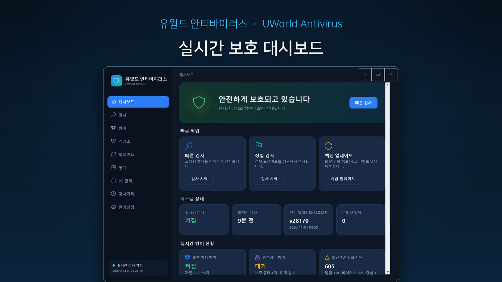
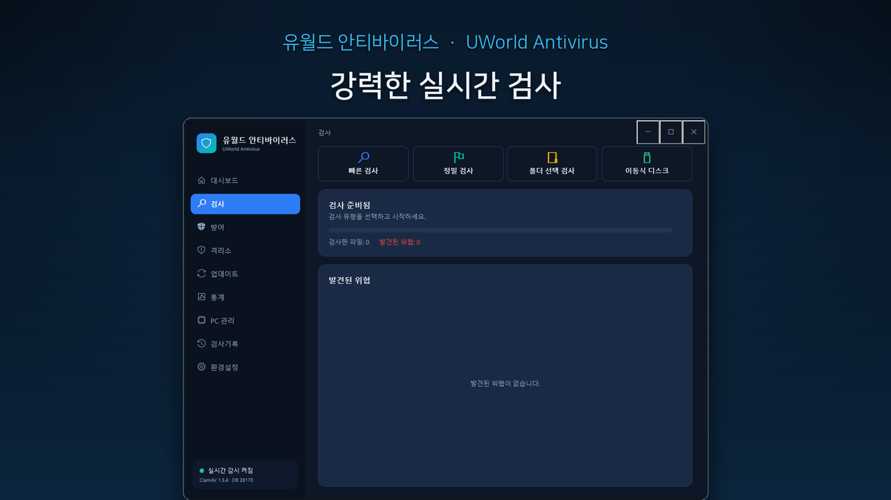
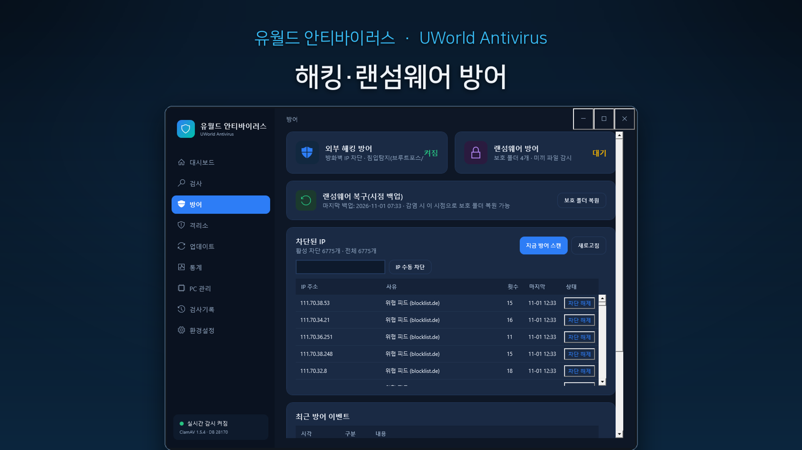
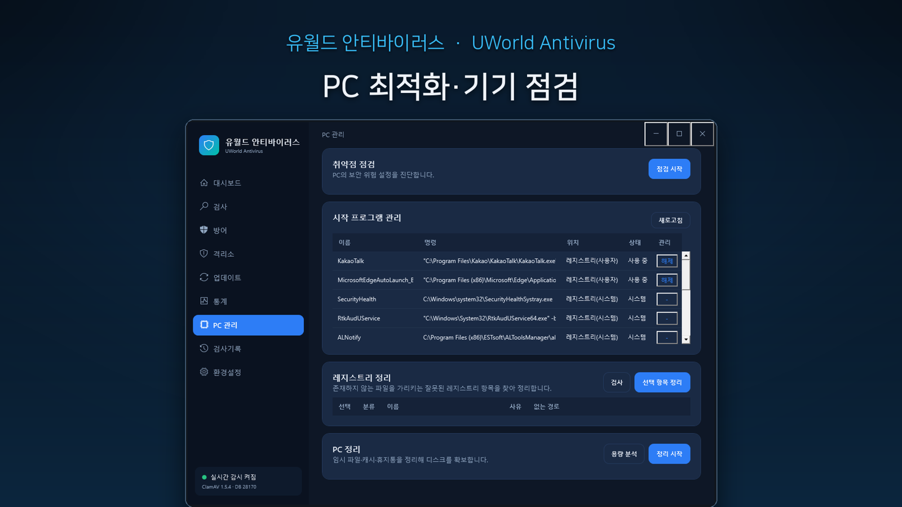
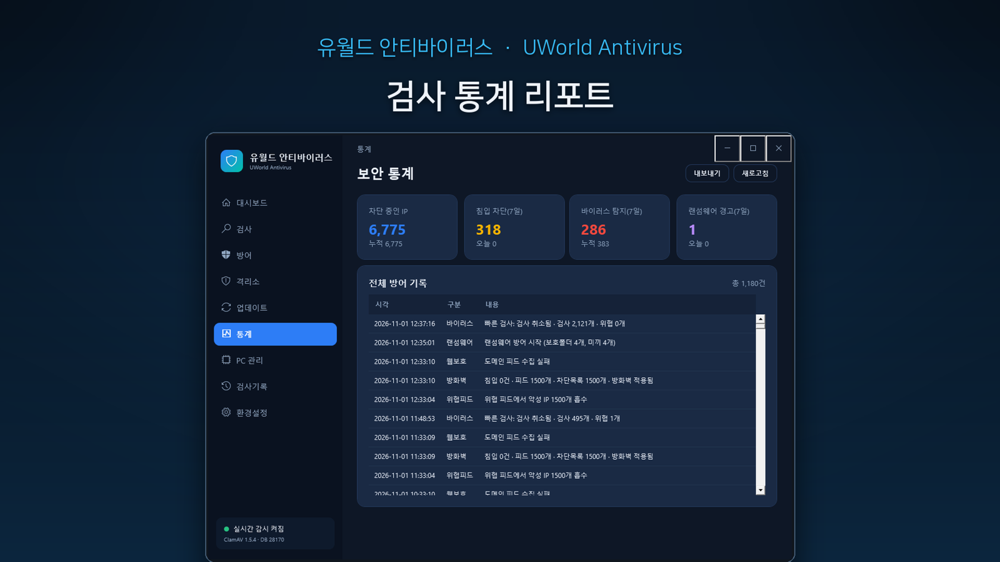
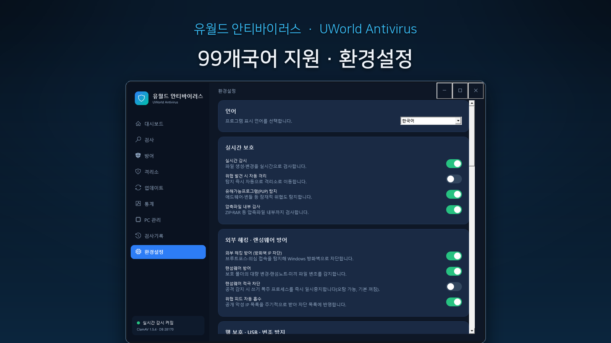

<div align="center">

# UWorld Antivirus · 유월드 안티바이러스

**Fast, privacy-first antivirus — free for everyone, at home and at work.**
**빠르고 프라이버시를 지키는 백신 — 개인·기업 모두 완전 무료.**

[](https://github.com/UWorld-Group/uworldantivirus/releases/latest)
[](https://github.com/UWorld-Group/uworldantivirus/releases)

| Windows | macOS | Linux | Android | iPhone · iPad |
|:---:|:---:|:---:|:---:|:---:|
| [**Download**](https://github.com/UWorld-Group/uworldantivirus/releases/latest) | [**DMG**](https://github.com/UWorld-Group/uworldantivirus/releases/latest) (Apple silicon) | [**.deb** · **.tar.gz**](https://github.com/UWorld-Group/uworldantivirus/releases/latest) | [Google Play](https://play.google.com/store/apps/details?id=co.uworld.uworld_vaccine) | [App Store](https://apps.apple.com/app/id6816079514) |

</div>

## Screenshots · 화면

<p align="center">
  
  
</p>
<p align="center">
  
  
</p>
<p align="center">
  
  
</p>

---

## Why UWorld Antivirus · 왜 유월드 안티바이러스인가

UWorld Antivirus is a full-featured antivirus built on the trusted **ClamAV** engine. It scans files for malware, defends against hacking and ransomware, and keeps its signatures up to date automatically — and it does all of this **on your device**. There is no account to create, no ads, no tracking, and your files are never uploaded anywhere.

유월드 안티바이러스는 검증된 **ClamAV** 엔진을 바탕으로 만든 풀기능 백신입니다. 악성코드 검사, 해킹·랜섬웨어 방어, 시그니처 자동 업데이트를 모두 **내 기기 안에서** 처리합니다. 회원가입도, 광고도, 추적도 없고 파일이 외부로 전송되지 않습니다.

It is **completely free for both personal and business use**, and speaks **99 languages** out of the box — so the same protection works for a home PC, a small office, or a whole team.

**개인과 기업 모두 완전 무료**이며 **99개 언어**를 기본으로 지원합니다. 집 PC부터 작은 사무실, 회사 전체까지 같은 보호를 그대로 쓸 수 있습니다.

## Features · 주요 기능

### 🛡️ Real-time protection · 실시간 보호
- New and changed files are checked the moment they appear, with a resident engine that keeps signatures loaded for speed.
  새로 생기거나 바뀐 파일을 바로 검사합니다. 상주 엔진이 시그니처를 메모리에 올려 두어 빠릅니다.

### 🔍 Fast scanning · 빠른 검사
- Quick, full, custom-folder and removable-drive scans, powered by ClamAV signatures and parallel resident-engine scanning.
  빠른 검사·정밀 검사·폴더 선택 검사·이동식 디스크 검사를 ClamAV 시그니처와 상주 엔진 병렬 검사로 빠르게 수행합니다.

### 🔒 Hacking & ransomware defense · 해킹·랜섬웨어 방어
- Blocks repeated intrusion attempts with the firewall and protects important folders against ransomware.
  반복되는 침입 시도를 방화벽으로 차단하고, 중요한 폴더를 랜섬웨어로부터 보호합니다.

### 🧪 Quarantine · 격리·치료
- Threats are moved to a safe quarantine where you can restore or delete them.
  발견된 위협은 안전한 격리소로 옮겨지고, 복원하거나 삭제할 수 있습니다.

### 🧹 PC care & security check · PC 최적화·기기 점검
- Check for weak security settings, manage startup programs and clean up unnecessary files.
  취약한 보안 설정을 점검하고, 시작 프로그램을 관리하고, 불필요한 파일을 정리합니다.

### 🔄 Automatic signature updates · 시그니처 자동 업데이트
- Virus signatures update automatically, and the app tells you when a new version is available.
  바이러스 시그니처가 자동으로 업데이트되고, 새 버전이 나오면 앱이 알려 줍니다.

### 📊 Statistics & history · 통계·검사 기록
- See blocked attacks, scans and detections at a glance, with a detailed event history.
  차단한 공격·검사·탐지 현황을 한눈에 보고, 자세한 이벤트 기록을 확인합니다.

### 🌐 99 languages, 100% local · 99개 언어·100% 로컬
- Works fully offline in 99 languages. No account, no ads, no tracking.
  99개 언어를 오프라인으로 지원합니다. 계정·광고·추적이 없습니다.

---

## Install · 설치 안내

### Windows

**Requirements · 사양**: Windows 10 / 11 (64-bit), administrator rights for installation.

1. Download **`UWorldAntivirus-<version>-windows-x64-setup.exe`** from the [latest release](https://github.com/UWorld-Group/uworldantivirus/releases/latest).
   [최신 릴리스](https://github.com/UWorld-Group/uworldantivirus/releases/latest)에서 설치 파일을 내려받습니다.
2. Run it and follow the installer. The installer is code-signed by **유월드 (UWorld)**.
   실행하면 설치가 진행됩니다. 설치 파일은 "유월드" 이름으로 서명되어 있습니다.
3. *(Optional)* Verify the file with `SHA256SUMS.txt` from the same release:
   *(선택)* 같은 릴리스의 `SHA256SUMS.txt` 로 파일이 변조되지 않았는지 확인할 수 있습니다.
   ```powershell
   Get-FileHash .\UWorldAntivirus-<version>-windows-x64-setup.exe -Algorithm SHA256
   ```

### macOS (DMG)

**Requirements · 사양**: macOS 12 or later, **Apple silicon (M1 or later)**.

1. Download **`UWorldAntivirus-<version>-macos-arm64.dmg`** from the [latest release](https://github.com/UWorld-Group/uworldantivirus/releases/latest) and open it.
   최신 릴리스에서 DMG를 내려받아 엽니다.
2. Drag **UWorld Vaccine** onto **Applications** and launch it. The app is signed with UWorld's Developer ID and **notarized by Apple**, so it opens with a normal double-click.
   **UWorld Vaccine** 을 응용 프로그램 폴더로 끌어다 놓고 실행합니다. 유월드 Developer ID 서명과 Apple 공증을 받은 앱이라 더블클릭으로 바로 열립니다.
3. *(Optional)* Verify the file:
   *(선택)* 파일 확인:
   ```bash
   shasum -a 256 UWorldAntivirus-<version>-macos-arm64.dmg
   ```

### Linux (self-hosted server · 자체호스팅 서버)

**Requirements · 사양**: Linux with systemd, Node.js 18+, ClamAV. Architecture-independent.

A server/daemon edition with a web dashboard. It runs fully offline, collects no personal data, and generates a strong access key at install time.
웹 대시보드형 서버/데몬 에디션입니다. 완전 오프라인으로 동작하고 개인정보를 수집하지 않으며, 설치 시 접속 암호키가 자동 발급됩니다.

```bash
# Debian / Ubuntu
sudo apt-get install -y clamav clamav-freshclam nodejs
sudo dpkg -i UWorldAntivirus-<version>-linux.deb
sudo uworld-vaccine key show          # dashboard access key · 대시보드 접속 키
# → http://127.0.0.1:8477

# Other distributions
tar xzf UWorldAntivirus-<version>-linux.tar.gz && cd uworld-vaccine-*-linux && sudo ./install.sh
```

### Android · iPhone

Install from [Google Play](https://play.google.com/store/apps/details?id=co.uworld.uworld_vaccine) or the [App Store](https://apps.apple.com/app/id6816079514). The mobile apps provide file scanning and safe browsing.
[Google Play](https://play.google.com/store/apps/details?id=co.uworld.uworld_vaccine) 또는 [App Store](https://apps.apple.com/app/id6816079514)에서 설치하세요. 모바일 앱은 파일 검사와 안전한 웹 브라우징을 제공합니다.

---

## About this repository · 이 저장소에 대해

This repository is used **only to distribute installers**. The source code is not published here.
The "Source code" archives that GitHub attaches to every release contain only this README, the license and screenshots.

이 저장소는 **설치 파일 배포 전용**입니다. 앱 소스코드는 공개하지 않으며, 릴리스마다 GitHub가 자동으로 붙이는 "Source code" 압축 파일에는 이 안내문·사용권 안내·화면 이미지만 들어 있습니다.

UWorld Antivirus uses the ClamAV® engine and virus signatures. ClamAV is a registered trademark of Cisco Systems, Inc.
유월드 안티바이러스는 ClamAV® 엔진과 바이러스 시그니처를 사용합니다. ClamAV는 Cisco Systems, Inc.의 등록 상표입니다.

## Support · 문의

- Website · 웹사이트: https://service.uworld.co.kr

<div align="center">

Part of **[UWorld Group](https://github.com/UWorld-Group)** · See [LICENSE.txt](LICENSE.txt) · © UWorld. All rights reserved.

</div>
